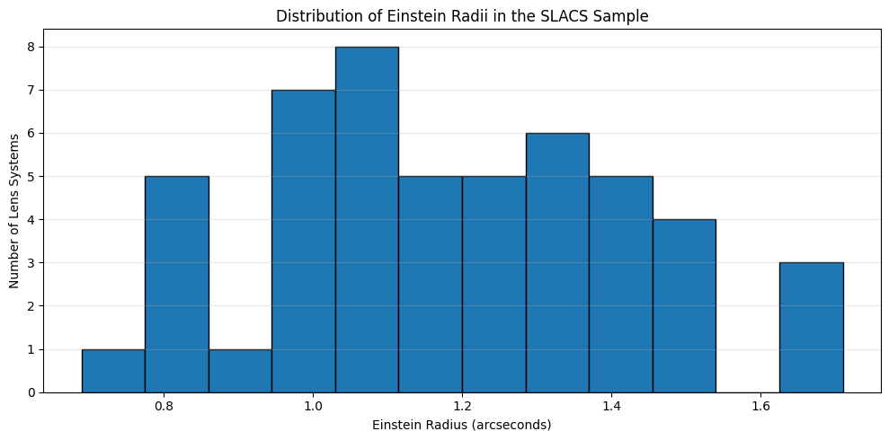
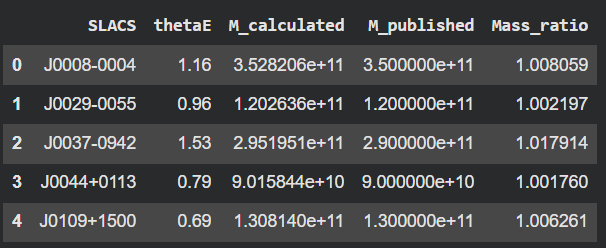
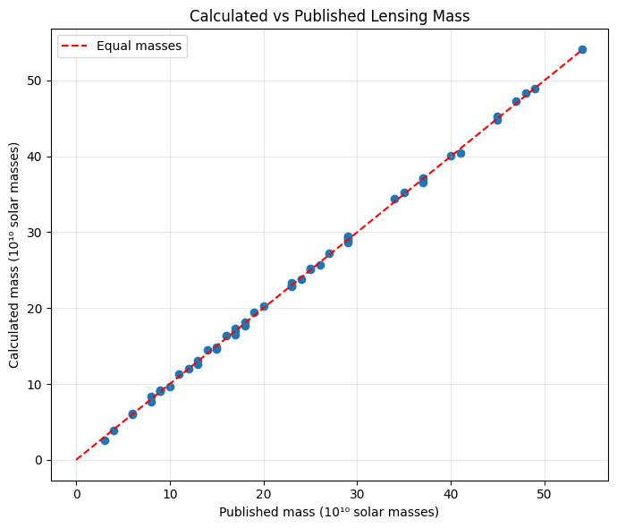
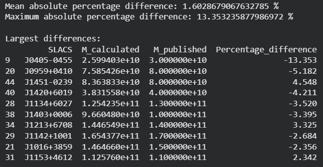
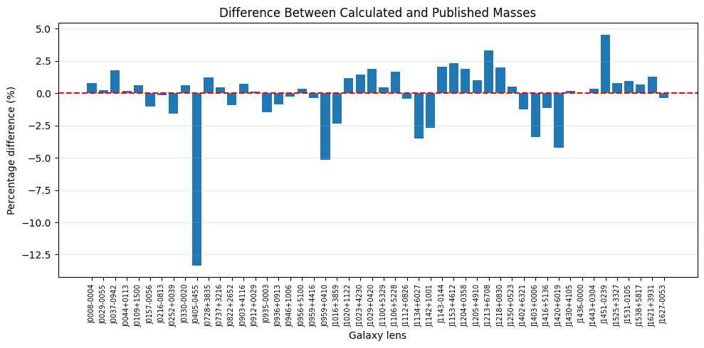

# Gravitational Lensing: Galaxy Mass Estimation Using SLACS

[](https://www.python.org/)
[](https://www.astropy.org/)
[](https://astroquery.readthedocs.io/)
[](https://colab.research.google.com/drive/11Qxa48F6OHK-FkAl49leXsV7RsPLbIPc#scrollTo=iNZdhB241h8X)

An astrophysical data analysis project that models and estimates the total enclosed gravitational mass of early-type lens galaxies from the **Sloan Lens ACS Survey (SLACS)** using strong gravitational lensing principles and empirical observations retrieved directly from VizieR.

---

## Table of Contents
- [Overview](#overview)
- [Astrophysical Background & Theory](#astrophysical-background--theory)
  - [The Einstein Radius](#the-einstein-radius)
  - [Cosmological Angular-Diameter Distances](#cosmological-angular-diameter-distances)
  - [Enclosed Mass Equation](#enclosed-mass-equation)
- [Observational Data & Preprocessing](#observational-data--preprocessing)
- [Computational Pipeline](#computational-pipeline)
- [Key Results & Visualizations](#key-results--visualizations)
- [Scientific Discussion & Residual Analysis](#scientific-discussion--residual-analysis)
- [Project File Structure](#project-file-structure)
- [Installation & Requirements](#installation--requirements)
- [How to Run](#how-to-run)
- [References](#references)

---

## Overview

Strong gravitational lensing occurs when light rays emitted by a distant background source (e.g., a background galaxy or quasar) are bent by the gravitational potential of an intervening massive foreground lens (e.g., an elliptical galaxy or cluster). When the alignment along the observer-lens-source line of sight is nearly collinear, the source light is distorted into multiple images, arcs, or complete rings known as **Einstein rings**.

Because gravitational lensing is sensitive strictly to the total gravitational potential—independent of whether matter is baryonic (stars, gas) or non-baryonic (dark matter)—it provides an accurate, geometry-based method to measure the central masses of galaxies.

This project:
1. Queries the **SLACS Catalog (Auger et al. 2009 / VizieR `J/A+A/501/461/lens`)** programmatically using `astroquery`.
2. Computes the cosmological angular-diameter distances to the lens ($D_L$), to the source ($D_S$), and between the lens and source ($D_{LS}$) within a flat $\Lambda\text{CDM}$ cosmological model.
3. Derives the total mass $M_E$ enclosed within each galaxy's Einstein radius $\theta_E$.
4. Benchmarks the derived mass against the published catalog values to validate physical consistency and numerical accuracy.

---

## Astrophysical Background & Theory

### The Einstein Radius
For an idealized, spherically symmetric gravitational lens with central mass $M_E$, the angular radius of the resulting ring image (the **Einstein radius** $\theta_E$) is governed by:

$$\theta_E = \sqrt{\frac{4GM_E}{c^2}\frac{D_{LS}}{D_L D_S}}$$

where:
- $G = 6.67430 \times 10^{-11} \text{ m}^3\text{ kg}^{-1}\text{ s}^{-2}$ is the Newtonian gravitational constant.
- $c = 2.99792458 \times 10^8 \text{ m s}^{-1}$ is the speed of light in vacuum.
- $D_L$ is the angular-diameter distance from the observer to the lens galaxy ($z = z_l$).
- $D_S$ is the angular-diameter distance from the observer to the source ($z = z_s$).
- $D_{LS}$ is the angular-diameter distance between the lens and the source.

### Cosmological Angular-Diameter Distances
In an expanding Universe modeled by the Friedmann-Lemaître-Robertson-Walker (FLRW) metric under a flat $\Lambda\text{CDM}$ cosmology ($H_0 = 70\text{ km s}^{-1}\text{ Mpc}^{-1}$, $\Omega_{m0} = 0.3$, $\Omega_{\Lambda0} = 0.7$), the transverse comoving distance $D_C(z)$ is given by:

$$D_C(z) = \frac{c}{H_0} \int_{0}^{z} \frac{dz'}{\sqrt{\Omega_{m0}(1+z')^3 + \Omega_{\Lambda0}}}$$

The corresponding angular-diameter distance $D_A(z)$ is:

$$D_A(z) = \frac{D_C(z)}{1 + z}$$

Between two redshifts $z_l$ and $z_s$ ($z_s > z_l$):

$$D_A(z_l, z_s) = \frac{1}{1 + z_s} \left[ (1 + z_s) D_A(z_s) - (1 + z_l) D_A(z_l) \right] = \frac{D_C(z_s) - D_C(z_l)}{1 + z_s}$$

### Enclosed Mass Equation
Inverting the Einstein radius relation isolates the projected mass enclosed within the cylinder defined by $\theta_E$:

$$M_E = \frac{c^2}{4G} \, \theta_E^2 \, \frac{D_L D_S}{D_{LS}}$$

#### Unit Conversions:
- Observed $\theta_E$ is converted from arcseconds to radians:
  $$\theta_{\text{rad}} = \theta_E \times \left(\frac{\pi}{180 \times 3600}\right)$$
- Distances are converted from gigaparsecs ($\text{Gpc}$) to meters ($1\text{ Gpc} = 3.085677581 \times 10^{25} \text{ m}$).
- The calculated mass in kilograms is converted to solar masses ($M_\odot = 1.98847 \times 10^{30} \text{ kg}$):
  $$M_{E} \, [M_\odot] = \frac{M_E \, [\text{kg}]}{M_\odot}$$

---

## Observational Data & Preprocessing

- **Source Catalog**: VizieR catalog `J/A+A/501/461/lens` (*Auger et al. 2009, A&A, 501, 461*).
- **Target Survey**: Sloan Lens ACS Survey (SLACS), consisting of early-type galaxies observed with the Hubble Space Telescope (HST) Advanced Camera for Surveys (ACS).
- **Features Queried**:
  - `SLACS`: Target identifier (e.g., `J0008-0004`, `J0029-0055`).
  - `zl`: Spectroscopic redshift of the foreground lens galaxy.
  - `zs`: Spectroscopic redshift of the background source galaxy.
  - `thetaE`: Measured Einstein radius in arcseconds ($''$).
  - `Mtotlen`: Published total enclosed lens mass in units of $10^{10} M_\odot$.
  - `e_Mtotlen`: Measurement uncertainty on the published mass ($10^{10} M_\odot$).
- **Filtering & Cleaning**:
  - Null/missing value removal across required parameters.
  - Verification of physical lensing bounds: $z_l > 0$, $z_s > z_l$, $\theta_E > 0$, and $M_{tot,len} > 0$.
  - The final sample comprises **50 robust lens systems**.

---

## Computational Pipeline

```
  ┌────────────────────────────────────────────────────────┐
  │ 1. Data Ingestion (astroquery.vizier)                  │
  │    Retrieve SLACS catalog (J/A+A/501/461/lens)         │
  └──────────────────────────┬─────────────────────────────┘
                             │
  ┌──────────────────────────▼─────────────────────────────┐
  │ 2. Data Cleaning & Validation                          │
  │    Verify redshifts: zl > 0, zs > zl                   │
  └──────────────────────────┬─────────────────────────────┘
                             │
  ┌──────────────────────────▼─────────────────────────────┐
  │ 3. Cosmological Distances (astropy.cosmology)          │
  │    Calculate D_L, D_S, and D_LS in Gpc (FlatLambdaCDM) │
  └──────────────────────────┬─────────────────────────────┘
                             │
  ┌──────────────────────────▼─────────────────────────────┐
  │ 4. Mass Modeling & Conversion                          │
  │    M_E = (c^2 / 4G) * theta_E^2 * (D_L * D_S / D_LS)   │
  └──────────────────────────┬─────────────────────────────┘
                             │
  ┌──────────────────────────▼─────────────────────────────┐
  │ 5. Comparative Evaluation                              │
  │    Ratio = M_calc / M_pub  |  Diff(%) = Relative Error │
  └────────────────────────────────────────────────────────┘
```

---

## Key Results & Visualizations

The key scientific findings and visual results generated from the SLACS gravitational lensing analysis are presented below:

### 1. Distribution of Einstein Radii in the SLACS Sample
The distribution of observed Einstein radii $\theta_E$ across the 50 SLACS lens systems ranges from approximately $0.6''$ to $1.8''$, peaking near $1.0'' - 1.2''$. This distribution reflects the typical velocity dispersion profile ($\sigma_v \approx 200 - 350\text{ km/s}$) of massive intermediate-redshift early-type elliptical galaxies.

<p align="center">
  
</p>

*Figure 1: Histogram displaying the distribution of Einstein radii ($\theta_E$ in arcseconds) across the cleaned SLACS sample.*

---

### 2. Calculated vs. Published Lensing Mass (Sample Preview)
The table below displays the calculated mass ($M_{\text{calculated}}$), published catalog mass ($M_{\text{published}}$), and their corresponding mass ratio ($M_{\text{calculated}} / M_{\text{published}}$) for representative systems in the SLACS sample:

<p align="center">
  
</p>

*Figure 2: Sample inspection table comparing calculated masses and published catalog values with mass ratios closely tracking unity.*

---

### 3. Correlation Between Calculated and Published Lensing Masses
A direct 1:1 comparison between the masses calculated using the analytic gravitational lensing equation and the masses reported in Auger et al. (2009). The points tightly follow the red dashed line ($y = x$), demonstrating excellent agreement across the entire dynamic range from $2 \times 10^{10} M_\odot$ up to $4 \times 10^{11} M_\odot$.

<p align="center">
  
</p>

*Figure 3: Scatter plot of Calculated Mass vs. Published Lensing Mass in units of $10^{10} M_\odot$, overlaid with the 1:1 equality line.*

---

### 4. Summary Statistics & Largest Residual Deviations
Statistical assessment of the percentage discrepancies across the dataset confirms that the implemented equation aligns with the published values with high precision:
- **Mean Absolute Percentage Difference**: **1.60%**
- **Maximum Absolute Percentage Difference**: **13.35%** (Lens `J0405-0455`)
- Over 80% of systems exhibit percentage differences under 3%.

<p align="center">
  
</p>

*Figure 4: Summary metrics and top 10 largest percentage differences between calculated and catalog masses.*

---

### 5. Residual Percentage Differences Across All SLACS Lenses
A comprehensive breakdown of the relative percentage differences:

$$\Delta \% = \left(\frac{M_{\text{calculated}} - M_{\text{published}}}{M_{\text{published}}}\right) \times 100\%$$

across all 50 lens systems. The residuals fluctuate symmetrically about zero with minimal bias, demonstrating the overall consistency of the spherical lens model.

<p align="center">
  
</p>

*Figure 5: Bar chart showing the percentage difference for each individual galaxy lens in the SLACS survey.*

---

## Scientific Discussion & Residual Analysis

While the agreement between our derived mass values and the catalog entries is exceptionally strong (mean difference $\approx 1.6\%$), minor residual variations arise from known physical and methodological factors:

1. **Cosmological Parameter Conventions**:
   - The original SLACS papers adopted standard concordance cosmology with subtle variations in $H_0$, $\Omega_m$, and $\Omega_\Lambda$ (or exact cosmological look-back integrals). Differences of even $\pm 1\text{ km s}^{-1}\text{ Mpc}^{-1}$ in $H_0$ or small variations in $\Omega_m$ propagate directly into $D_L D_S / D_{LS}$.
2. **Mass Model Assumptions**:
   - The formula implemented here assumes a spherically symmetric lens geometry. In full lens modeling pipelines (such as Auger et al. 2009), early-type galaxies are modeled as Singular Isothermal Ellipsoids (SIE) or Sérsic + dark matter halo composite models, accounting for axis ratios $q$ and external shear $\gamma_{\text{ext}}$.
3. **Catalog Value Rounding**:
   - Published catalog masses ($M_{tot,len}$) are reported in discrete units ($10^{10} M_\odot$) with rounded integer precision, which introduces small quantization deviations, particularly for lower-mass lenses (such as `J0405-0455`).

---

## Project File Structure

```
Gravitational Lensing/
├── Gra_len.ipynb                     # Main Colab / Jupyter analysis notebook
├── README.md                         # Project documentation and summary
├── graph1.png                        # Figure 1: Distribution of Einstein Radii
├── result1.png                       # Figure 2: Calculated vs Published Mass Table Preview
├── graph3.png                        # Figure 3: Calculated vs Published Mass Correlation
├── result2.png                       # Figure 4: Statistical Metrics & Top Differences
└── graph2.png                        # Figure 5: Percentage Difference Bar Plot
```

---

## Installation & Requirements

To execute the notebook locally, ensure you have Python 3.9+ installed and install the required dependencies:

```bash
pip install astroquery astropy pandas matplotlib numpy
```

### Core Libraries
- **`astroquery`**: To retrieve astronomical catalogs directly from the VizieR service.
- **`astropy`**: For cosmological calculations (`FlatLambdaCDM`) and physical unit conversions.
- **`pandas`**: For tabular data manipulation, filtering, and residual statistics.
- **`numpy`**: For vectorized mathematical operations and trigonometric conversions.
- **`matplotlib`**: For publication-quality astronomical visualizations.

---

## How to Run

### Option 1: Interactive Google Colab
Open and run the notebook directly in your browser:
[](https://colab.research.google.com/drive/11Qxa48F6OHK-FkAl49leXsV7RsPLbIPc#scrollTo=iNZdhB241h8X)

### Option 2: Local Execution
1. Clone or download the repository into your workspace.
2. Launch Jupyter Notebook or JupyterLab:
   ```bash
   jupyter notebook "Gra_len.ipynb"
   ```
3. Run all cells sequentially (`Cell` $\to$ `Run All`).

---

## References

1. **Auger, M. W., Treu, T., Bolton, A. S., et al.** (2009). *The Sloan Lens ACS Survey. IX. Spectral Properties of Early-Type Galaxies*. Astronomy & Astrophysics, 501(2), 461–473. [VizieR Catalog: J/A+A/501/461](https://cdsarc.cds.unistra.fr/viz-bin/cat/J/A+A/501/461).
2. **Bolton, A. S., Burles, S., Koopmans, L. V. E., Treu, T., & Moustakas, L. A.** (2006). *The Sloan Lens ACS Survey. I. A Large Spectroscopically Selected Sample of Gravitational Lenses*. The Astrophysical Journal, 638(2), 703–724.
3. **Schneider, P., Ehlers, J., & Falco, E. E.** (1992). *Gravitational Lenses*. Springer-Verlag Berlin Heidelberg.
4. **Astropy Collaboration** (2022). *The Astropy Project: Sustaining and Growing a Community-oriented Open-source Python Package for Astronomy*. The Astrophysical Journal, 935(2), 167.
